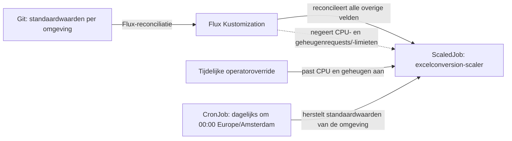

# Over selectieve driftcorrectie in Flux en de nachtelijke reset

## Het probleem

De Excel-conversion-`ScaledJob` wordt beheerd door Flux. Dat is normaal gesproken nuttig: Flux vergelijkt het actieve object met de gewenste status in Git en herstelt afwijkingen. Dit betekent ook dat een tijdelijke CPU- of geheugenwijziging met `kubectl` tijdens een reconciliatie kan worden teruggedraaid.

Voor tijdelijke aanpassingen van resources bieden de selectieve driftregels van Flux een oplossing op veldniveau. De Flux-`Kustomization` die eigenaar is van `excelconversion-scaler` kan alleen de paden voor CPU- en geheugenrequests en -limieten negeren. Flux blijft de overige velden reconciliëren en laat deze vier resourcewaarden na de eerste toepassing ongemoeid.

Operators kunnen zo de workload tijdelijk aanpassen zonder reconciliatie voor de hele `ScaledJob` of de bijbehorende `Kustomization` uit te schakelen.

## Werking van de nachtelijke reset

Zodra de ignore-regels onderdeel zijn van de beheerde Flux-configuratie, kan een CronJob binnen de namespace de vier genegeerde velden dagelijks om middernacht terugzetten op de standaardwaarden van die omgeving. De tijdzone is `Europe/Amsterdam`. Omdat Flux deze paden negeert bij driftcorrectie, draait Flux de reset van de CronJob niet direct terug. De overige velden blijven door Flux beheerd.

De standaardwaarden in Git en in de CronJob moeten gelijk blijven. Een wijziging van de genegeerde waarden in Git wordt niet vanzelf doorgevoerd zolang de ignore-regels actief zijn.

## Waarom dit in de huidige uitrol nog niet kan

De selectieve ignore-regel is `.spec.ignore` op een Flux-`Kustomization` van het type `kustomize.toolkit.fluxcd.io/v1`. De huidige clusteruitrol beheert Flux via de Azure-resource `Microsoft.KubernetesConfiguration/fluxConfigurations`, met Bicep-API-versie `2024-11-01`.

Het Bicep-schema voor die API-versie biedt geen `ignore`-property bij de `kustomizations`-items. Ook in het nieuwste schema dat Microsoft Learn momenteel vermeldt (`2025-04-01`) ontbreekt deze property. De huidige, door Bicep beheerde uitrol biedt dus geen ondersteunde manier om deze ignore-regels te declareren. Zonder die regels kan Flux een override terugdraaien voordat de CronJob de waarden herstelt. Daarom is het nog niet veilig om dit ontwerp via deze configuratie uit te rollen.

Dit is een beperking van de huidige Azure/Bicep-configuratieroute, niet van de Flux-functionaliteit zelf. Herzie het ontwerp zodra de resourceprovider de property ondersteunt, of wanneer de Flux-configuratie van het cluster via een andere route wordt beheerd waarmee `.spec.ignore` op de eigenaar-`Kustomization` kan worden ingesteld. Controleer daarnaast vóór ingebruikname of de geïnstalleerde Flux-controller en CRD de ignore-regels ondersteunen.

## Gerelateerde documentatie

- [Plan: handmatige CPU- en geheugenoverrides voor Excel-conversion](keda-manual-cpu-memory-reset-plan.md)
- [Selectieve driftcorrectie met ignore-regels](https://fluxcd.io/blog/2026/08/ignore-rules-drift-detection/)
- [Flux Kustomization-ignore-regels](https://fluxcd.io/flux/components/kustomize/kustomizations/#ignore-rules)
- [Bicep-referentie voor Microsoft.KubernetesConfiguration/fluxConfigurations](https://learn.microsoft.com/en-us/azure/templates/microsoft.kubernetesconfiguration/fluxconfigurations)
