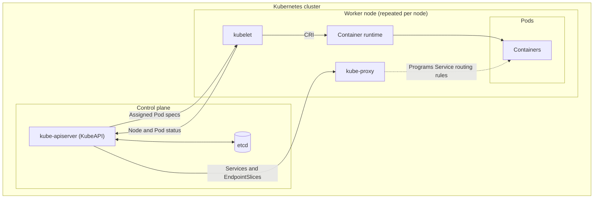

# Kubernetes Course Notes

Reference notes reorganized from the Kubernetes course export. These are concise reminders, not a complete Kubernetes specification. Version- and cluster-specific behavior is linked to official references.

## Cluster architecture

- **kube-apiserver (KubeAPI):** exposes the Kubernetes API and handles requests to read or change cluster resources.
- **etcd:** stores Kubernetes cluster state as key-value data. The API server reads and writes this state.
- **kubelet:** runs on each node, watches for Pods assigned to that node, ensures their containers are running, and reports status to the API server.
- **kube-proxy:** watches Service and EndpointSlice data and configures node networking rules so Service traffic can reach Pod endpoints.
- **Pods:** the smallest deployable Kubernetes units; each contains one or more co-located containers that share a network namespace and can share volumes.
- **Container runtime:** a CRI-compatible component, such as containerd or CRI-O, that downloads images and starts or stops containers for the kubelet.

## Workloads and controllers

- A **Pod** is the smallest Kubernetes object that runs one or more tightly coupled containers.
- A **ReplicaSet** maintains a requested number of matching Pod replicas. In normal application deployments, a Deployment manages ReplicaSets rather than having users manage ReplicaSets directly.
- A **Deployment** describes a desired state for stateless application Pods and supports rolling updates and rollout history. `kubectl rollout undo` can revert a Deployment to a previous revision.
- A **DaemonSet** runs a Pod on each eligible node (or on a selected subset of nodes). It is not a ReplicaSet-per-node.
- A **Job** runs work to completion. Use a Deployment for a continuously running service or worker. KEDA's `ScaledObject` scales a Deployment or StatefulSet; a `ScaledJob` creates Jobs in response to events.

The source note describes a long-running validation function being deployed as a Job and also as a one-replica Deployment to expose secrets. Treat that as a historical workaround, not a general Kubernetes pattern. Secret delivery should be designed independently of whether work is scheduled as a Job or Deployment.

References: [Deployments](https://kubernetes.io/docs/concepts/workloads/controllers/deployment/), [ReplicaSets](https://kubernetes.io/docs/concepts/workloads/controllers/replicaset/), [DaemonSets](https://kubernetes.io/docs/concepts/workloads/controllers/daemonset/), [Jobs](https://kubernetes.io/docs/concepts/workloads/controllers/job/).

## Configuration and secrets

- A **ConfigMap** stores non-confidential configuration as key-value data. It can be exposed as environment variables or mounted files.
- A **Secret** stores sensitive values in the Kubernetes API. The usual YAML representation is base64 encoded, which is not encryption. Access should be limited with RBAC, and encryption at rest depends on cluster configuration.
- `envFrom.configMapRef` and `envFrom.secretRef` belong under a container. A reference resolves in the Pod's namespace; namespaced resources are not shared across namespaces.
- The Secrets Store CSI Driver can mount Key Vault values as files. Syncing those values into a Kubernetes Secret is a separate option and requires the provider's secret-sync configuration.

References: [ConfigMaps](https://kubernetes.io/docs/concepts/configuration/configmap/), [Secrets](https://kubernetes.io/docs/concepts/configuration/secret/), [AKS Key Vault CSI Driver](https://learn.microsoft.com/azure/aks/csi-secrets-store-driver).

## Networking

- **ClusterIP** exposes a Service on a cluster-internal IP and is the default Service type.
- **NodePort** exposes a Service through a port on each node. It is usually a building block rather than the preferred public entry point.
- **Ingress** routes HTTP(S) traffic into a cluster when an Ingress controller is installed. Creating an Ingress object alone does not provide a controller or load balancer.
- **Gateway API** provides a newer, extensible model for service networking. Its Gateway and HTTPRoute resources require the relevant implementation and CRDs.
- A typical Service DNS name is `<service>.<namespace>.svc.cluster.local`.

References: [Services](https://kubernetes.io/docs/concepts/services-networking/service/), [Ingress](https://kubernetes.io/docs/concepts/services-networking/ingress/), [Gateway API](https://gateway-api.sigs.k8s.io/).

## Health checks and resource limits

The source lists three probes and resource limits, but does not record thresholds or sizing values:

- **Startup probe** indicates whether a container has finished starting. While it has not succeeded, liveness and readiness checks are held back.
- **Liveness probe** detects a container that should be restarted.
- **Readiness probe** indicates whether a container should receive Service traffic.
- **Requests** inform scheduling and reserve capacity. **Limits** constrain resource use; CPU limits throttle and memory limit violations can lead to container termination.

Probe paths, delays, thresholds, requests, and limits must be set from the application's startup and resource profile. The source does not provide enough measurements to recommend values.

References: [Configure probes](https://kubernetes.io/docs/tasks/configure-pod-container/configure-liveness-readiness-startup-probes/), [Resource management for Pods and containers](https://kubernetes.io/docs/concepts/configuration/manage-resources-containers/).

## Persistent storage

- A **PersistentVolume (PV)** represents cluster storage. A **PersistentVolumeClaim (PVC)** requests storage and is namespaced.
- A PV's `claimRef` identifies the claim to which it is bound. Inspect it before investigating a binding conflict.
- With reclaim policy `Retain`, deleting the claim does not automatically erase the backing data or make the PV immediately reusable. A PV in `Released` may still need deliberate storage cleanup and administrative recovery.
- Do not delete a PVC or edit protection finalizers until the owning workload, reclaim policy, and data-retention requirements are understood.

Reference: [Persistent Volumes](https://kubernetes.io/docs/concepts/storage/persistent-volumes/).

## AKS command-line tools

The notes mention `az aks install-cli` and the `kubelogin` executable. AKS authentication can require `kubelogin` to be installed and discoverable on `PATH`; use the official [kubelogin installation and configuration guidance](https://learn.microsoft.com/azure/aks/kubelogin-authentication) for the current method. Avoid copying personal machine paths from the original notes.

`systemctl status kubelet` and `journalctl -u kubelet` are Linux node-level diagnostics. They may not be available to an AKS user and should only be used where node access is explicitly supported and authorized.

For commands grouped by task, see the [kubectl command cheat sheet](kubectl-cheat-sheet.md). For task-specific guidance, see the how-to guides linked from the [index](README.md).
